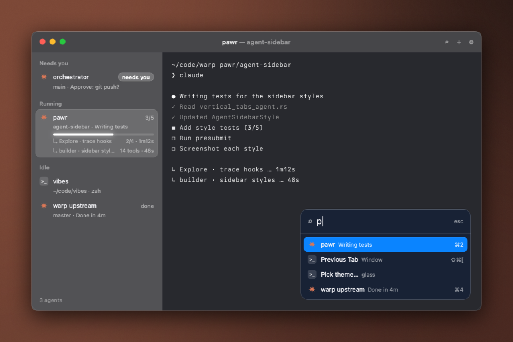

<div align="center">


# Glass

**A Haunt theme of frosted glass: your wallpaper shows through, blurred.**

[](https://github.com/highskore/haunt-hackathon)


[](LICENSE)



</div>

A Haunt theme of frosted glass. Your wallpaper shows through the sidebar, title bar, terminal and palette, blurred. The window has rounded corners and coloured traffic lights. Selected rows and the palette's selection are raised pills.

The screenshot is drawn over a fixed backdrop, not a real desktop.

## Install and switch

Glass ships with Haunt. To use this copy instead, run this from the repo:

```sh
haunt plugin install .
```

Switch to it from ⌘K ▸ Pick theme…, or set it in `~/.haunt/config.toml`:

```toml
theme = "glass"
```

## Fonts

Glass uses the system fonts, SF Pro and SF Mono, and ships no fonts of its own. The theme is MIT ([LICENSE](LICENSE)).

## Effects

`theme.toml` turns on these `[effects]` keys. Haunt's [themes guide](https://github.com/highskore/haunt/blob/main/docs/themes.md) describes each one.

- Window: `window.material = "glass"`, `window.radius`, `window.ring`, `titlebar.rule`, `titlebar.lights = "color"`
- Sidebar: `sidebar.footer`, `label.case`, `label.weight`, `row.inset`, `row.radius`, `needs.pill`, `bar.radius`, `bar.glow`, `bar.done`
- Layers: the raised selected row (shadow, highlight, ring) and the hover fill, in the sidebar and the palette
- Palette: `palette.material = "glass"`, `palette.blur`, `palette.font`, `palette.icons`, `palette.selection = "pill"`, `palette.foot`, `palette.scrim`, `palette.keys`, `palette.input.icon`, `palette.input.weight`, `palette.tab.sub`, `palette.modes`

Its `[ghostty]` table sets the terminal's background opacity to 0.55 with a blur of 20, so the wallpaper shows through the terminal too.
